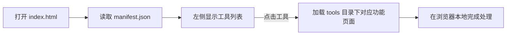
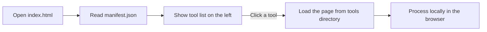

# 🧰 工具箱 Toolbox

> 一个开箱即用的本地文档处理工具箱 —— 纯前端、零依赖、无需服务器，所有操作都在你的浏览器里完成。


---

## 中文说明 / Chinese

### 📖 项目简介

**工具箱** 是一个完全在浏览器本地运行的文档处理工具合集。它由 `index.html` 提供统一的导航界面，通过 `manifest.json` 读取工具清单，并在右侧区域加载对应的功能页面。

它 **不依赖任何服务器**，**不需要安装软件**，**不会把你的文件上传到任何地方** —— 所有转换、合并、拆分操作都在你自己的电脑上完成，隐私安全。

### ✨ 功能特性

| 功能 | 说明 | 对应文件 |
| --- | --- | --- |
| 📝 Word 转 PDF | 将 Word 文档转换为 PDF | `tools/word-to-pdf.html` |
| 📚 合并 Word | 将多个 Word 文档合并为一个 | `tools/word-merge.html` |
| 🖼 图片转 PDF | 将多张图片批量转换为 PDF | `tools/images-to-pdf.html` |
| 📑 PDF 拆分为图片 | 将 PDF 的每一页导出为图片 | `tools/pdf-to-images.html` |
| 📎 合并 PDF | 将多个 PDF 文件合并为一个 | `tools/pdf-merge.html` |
| ✂️ 拆分 PDF | 将一个 PDF 按页拆分 | `tools/pdf-split.html` |
| 🔄 旋转 PDF 页面 | 旋转 PDF 页面的方向 | `tools/pdf-rotate.html` |

> 💡 7 个工具均可通过编辑 `manifest.json` 自由增删。

### 🧩 工作原理



### 📁 目录结构

```
my-toolbox/
├── index.html          # 入口主页（导航界面）
├── manifest.json       # 工具清单（工具名称与文件路径）
├── tools/              # 各功能页面目录
│   ├── word-to-pdf.html
│   ├── word-merge.html
│   ├── images-to-pdf.html
│   ├── pdf-to-images.html
│   ├── pdf-merge.html
│   ├── pdf-split.html
│   └── pdf-rotate.html
└── README.md
```

### 📥 使用方法

1. 下载本项目源码（点击页面右上角 **Code → Download ZIP**）；
2. 在项目目录下新建一个文件夹（**默认请命名为 `tools`**，与 `manifest.json` 中配置的目录保持一致）；
3. 将除了 `index.html` 以外的所有 `.html` 文件放入该文件夹；
4. 用浏览器打开 `index.html`，从左侧选择功能即可使用。

> ⚠️ **注意**：`manifest.json` 中默认配置的目录为 `tools/`。如果工具列表无法加载，请检查文件夹名是否与清单中的 `file` 路径一致。

### ⚙️ 技术说明

- 纯前端实现（HTML + JavaScript），无任何外部依赖；
- 所有文件处理均在本地浏览器内完成，文件不会被上传；
- 支持离线使用；
- 如需在线体验，请通过邮件联系作者（见下方声明）。

### 👤 作者声明 / Author's Note

> 这是工具源码，如需下载学习，下载后将除了"index.html"外的".html"文件放入tool文件夹（需自己新建），如需在线使用，请发邮件至 yuzeyuhan@yeah.net。
>
> 声明：作者是学生，维护或回复邮件很慢。

---

## English / 英文说明

### 📖 Introduction

**Toolbox** is a collection of document-processing utilities that runs entirely in your browser. `index.html` provides a unified navigation shell, `manifest.json` defines the tool list, and each tool is loaded as an individual page.

It requires **no server**, **no installation**, and **never uploads your files anywhere** — all conversion, merging and splitting happen locally on your own computer.

### ✨ Features

| Feature | Description | File |
| --- | --- | --- |
| 📝 Word to PDF | Convert Word documents to PDF | `tools/word-to-pdf.html` |
| 📚 Merge Word | Merge multiple Word documents into one | `tools/word-merge.html` |
| 🖼 Images to PDF | Batch convert images to PDF | `tools/images-to-pdf.html` |
| 📑 PDF to Images | Export each PDF page as an image | `tools/pdf-to-images.html` |
| 📎 Merge PDF | Merge multiple PDF files into one | `tools/pdf-merge.html` |
| ✂️ Split PDF | Split a PDF by pages | `tools/pdf-split.html` |
| 🔄 Rotate PDF Pages | Rotate the orientation of PDF pages | `tools/pdf-rotate.html` |

> 💡 All 7 tools can be freely added or removed by editing `manifest.json`.

### 🧩 How It Works



### 📁 Directory Structure

```
my-toolbox/
├── index.html          # Entry page (navigation shell)
├── manifest.json       # Tool manifest (names & file paths)
├── tools/              # Directory of tool pages
│   ├── word-to-pdf.html
│   ├── word-merge.html
│   ├── images-to-pdf.html
│   ├── pdf-to-images.html
│   ├── pdf-merge.html
│   ├── pdf-split.html
│   └── pdf-rotate.html
└── README.md
```

### 📥 Getting Started

1. Download the source code (click **Code → Download ZIP** at the top right of this page);
2. Create a folder in the project directory (**name it `tools` by default** to match the paths in `manifest.json`);
3. Put every `.html` file **except `index.html`** into that folder;
4. Open `index.html` in your browser and pick a tool from the left sidebar.

> ⚠️ **Note**: the default directory configured in `manifest.json` is `tools/`. If the tool list fails to load, check that the folder name matches the `file` paths in the manifest.

### ⚙️ Technical Notes

- Pure front-end (HTML + JavaScript), no external dependencies;
- All file processing happens locally in the browser — nothing is uploaded;
- Works offline;
- For online usage, please contact the author by email (see the note below).

### 👤 Author's Note

> This is the source code of the toolbox. To download and study it: after downloading, put every ".html" file **except "index.html"** into a "tool" folder (create it yourself). To use it online, please send an email to **yuzeyuhan@yeah.net**.
>
> Note: the author is a student, so maintenance and email replies may be slow.

---

## 📄 License / 许可

本项目仅供学习交流使用，未经作者许可请勿用于商业用途。

